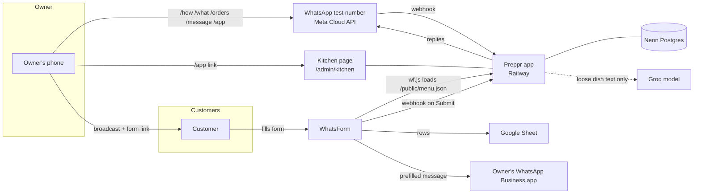

# Preppr docs

Start here. The repo README (`../README.md`) covers the full customer-ordering bot. This page covers **what's running for the kitchen right now**: the WhatsForm stopgap plus the owner's kitchen page and WhatsApp assistant. It also says where every piece of data lives and what's next.

## What we did on 2026-11-07

The kitchen owner wanted relief before the full bot is ready. We decided:

1. **Customers order through WhatsForm** (paid plan) instead of free-text WhatsApp messages. The owner keeps broadcasting the menu with a form link as she does today. → [`whatsform-interim.md`](whatsform-interim.md)
2. **The owner gets a private assistant** on a WhatsApp test number, plus a **kitchen page** (web). There she keeps her dishes and sizes, sets today's menu, and copies the WhatsForm lines and broadcast. She also sees orders, sales and how much to make. → [`owner-assistant.md`](owner-assistant.md)
3. **This is the start of the kitchen's database.** Products, menus, orders (from WhatsForm) and customers live in one Postgres database (Neon). The full bot will use the same database later.

Built today (all tested with fakes, deployed to Railway):

| Piece | Where in the code |
|---|---|
| Product list: dishes with sizes and prices (`products` table) | `src/db/schema.ts`, `src/domain/products.ts` |
| WhatsApp product/menu commands (`/add-product`, `/products`, `/menu 1,2,3`, `/link`). Strict code parser first; the model only for loose text, and its prices must appear in her message | `src/flows/catalog.ts`, `src/llm/*` (`parseProducts`) |
| Owner-only mode: strangers are recorded, never answered (`OWNER_ONLY=1`) | `src/flows/router.ts` |
| WhatsForm mode: Publish returns the broadcast with the permanent form link; the form shows the menu (`src/flows/formMenu.ts`, `formScript.ts`), no cutoff summary (`ORDER_CHANNEL=whatsform`) | `src/flows/owner.ts`, `src/domain/menu.ts`, `src/jobs/cutoff.ts` |
| Kitchen page `/admin/kitchen`: Today (menu → form steps → orders/sales → what to make → order list) and Products | `src/admin/kitchen.ts` |
| WhatsForm webhook intake → `form_responses`: answers matched to menu lines, priced in code, customer saved | `src/flows/formOrders.ts`, `src/domain/formOrders.ts` |
| Read-only day commands: `/how`, `/what`, `/orders`, `/message`, `/app` | `src/flows/ownerDay.ts` |
| Deploy on Railway, DB on Neon, model on Groq (free tier) | below |

Migrations added: `drizzle/0008_*` (products), `drizzle/0009_*` (form_responses).

## How it works

The owner's day:
1. **Set today's menu.** On WhatsApp: `today dal, paneer, roti` (or `same as yesterday but no rice`) → Publish. The kitchen page's Create today's menu still works too. Dishes are kept the same way (`add samosa 2 each`, `dal 16oz is 11 now`). → [`owner-assistant.md`](owner-assistant.md#plain-chat-dishes-and-the-daily-menu)
2. **Nothing to do in WhatsForm.** One permanent form shows the published menu with +/− buttons (Custom Script `/wf.js` + `/public/menu.json`). Publish replies with the broadcast, link included. → [`whatsform-interim.md`](whatsform-interim.md)
3. **Broadcast** to her list, as today.
4. **Orders come in.** Customers fill the form. WhatsForm posts each submission to us, and the page and `/how` `/what` `/orders` update. WhatsForm also keeps its own copy (Responses, Google Sheet), and the customer's prefilled message still lands in her WhatsApp Business app.

Rules that hold everywhere: **money is computed in code** from the menu (never from the model, never from the form's own "Total"). **Nothing the model reads is saved** until she confirms.

## Where things run

| What | Where | Notes |
|---|---|---|
| App | Railway: project `preppr`, service `preppr`, env `production`; `https://preppr-production.up.railway.app` | Railway account = the kitchen Gmail. Deploy with `railway up` from the repo (Dockerfile). **Use `railway up`, not `railway redeploy`**: redeploy keeps old variables. |
| Database | Neon project `preppr` (`muddy-forest-97061850`), branch `main`, pooled URL in Railway `DATABASE_URL` | Our Neon account (free). Migrations run at app start. |
| WhatsApp | Meta app `887855374352099` under the **kitchen's** business portfolio. Test number +1 555-178-8619 (phone number ID `1376560902216160`), WhatsApp account `2749872198780203` | Test number = only the verified "To" numbers (≤5) can use it. Token: long-lived user token, **expires 2027-01-06**. |
| Model | Groq, `openai/gpt-oss-120b` via `LLM_PROVIDER=openai`, `LLM_BASE_URL=https://api.groq.com/openai/v1` | Free tier. Hugging Face needs PRO or prepaid credit, so we didn't use it. |
| Orders form | WhatsForm, the owner's own account (free month, then Standard $24/mo) | Webhook needs Standard (check). |
| Secrets | `.env.assistant` (gitignored, local) → Railway variables via `scripts/railway-push-env.sh` | Never paste values in chat. `ADMIN_SECRET`, `JOB_SECRET`, `WA_VERIFY_TOKEN`, `DATABASE_URL` were generated or set directly in Railway. |

An earlier Meta app (`1876821257000074`, under our own business) was **locked by Meta** (error 131031). Remove its webhook or delete it.

## Where data lives

All in Neon Postgres (`src/db/schema.ts`):

| Table | What | Written by |
|---|---|---|
| `products` | Her dishes: name, sizes `[{label, price_cents}]`, active | Kitchen page, `/add-product` |
| `menus` | One per date: items (one per dish+size, with `product_id`, `size`), status | Kitchen page, `/menu` |
| `form_responses` | Each WhatsForm submission: matched lines, total (code-priced), name/phone/area/address/note, `unmatched`, raw body | WhatsForm webhook |
| `customers` | Phone → name, area, address (filled from WhatsForm submissions; only empty fields are filled, never overwritten) | WhatsForm webhook, `ADD`, contact cards |
| `kv` | `form_link` (the permanent order form link), `product_draft:*` (WhatsApp previews), alert markers | App |
| `messages`, `raw_webhooks`, `inbox`, `outbox`, `wa_statuses` | Every WhatsApp message in/out, as received/sent | App |
| `orders`, `payments` | The full bot's orders and ledger: **empty in this mode** | Full bot (later) |

Outside our database:
- **WhatsForm:** Responses, and its Google Sheet integration. This is the source of truth if our webhook missed something.
- **WhatsApp Business app:** the customer's prefilled order message, as today.

To look at the data: `psql "$(neon connection-string main --project-id muddy-forest-97061850 --pooled)"`.

## Backlog (in order)

**Before she uses it with customers**
1. **Verify the WhatsForm webhook with a real submission.** The payload shape is unconfirmed. Check `select raw, unmatched from form_responses order by id desc limit 1`. Adjust `src/domain/formOrders.ts` if keys don't match. Also check:
   - whether Duplicate keeps the webhook
   - whether her plan (free month) includes webhooks
2. **Rotate the Groq key**: it was pasted in chat. Make a new one and push it with the script.
3. **Commit everything** on `pilot-deploy` (nothing from today is committed yet).
4. **Remove the webhook** from the locked Meta app.

**Soon**
5. **Permanent WhatsApp token** (system user in the kitchen's Business Settings) before **2027-01-06**. Today's attempt failed with "No permissions available": the system user needs the app assigned (Assign assets → Apps → Full control), or the app added to the business first.
6. **Uptime alert** on `https://preppr-production.up.railway.app/healthz` (UptimeRobot), and `SENTRY_DSN` on Railway.
7. **Railway billing:** the trial credit runs out. Hobby plan on the kitchen's card.
8. **WhatsForm checks on setup day:**
   - the Calculation total (qty × price)
   - the webhook "key" names
   - whether Sheets is connected per form
9. **Kitchen page polish:**
   - edit or mark orders paid
   - a delivery list grouped by area
   - a "yesterday / this week" view (data is already there)

**Later**
10. **Customer list** on the page (from `customers` + `form_responses`): repeat customers, last order.
11. **Move off the test number:** a staging number, or her own number via coexistence (`coexistence-setup.md`, `i-want-to-get-happy-wren` plan). Once her number is on coexistence, broadcast lists go read-only, so the form link goes out through `src/jobs/menuPush.ts`. Same database throughout.
12. **The full bot** (customers order in chat) can replace WhatsForm, reusing `products`, `menus`, `customers`. `form_responses` and `orders` would need to be read together for history.
13. **Postgres CI job and backups** (`deploy/pilot/backup` isn't running on Railway; Neon's restore window is the only backup today).

## Other docs

| Doc | For |
|---|---|
| [`whatsform-interim.md`](whatsform-interim.md) | WhatsForm: plan, template form, daily steps, troubleshooting |
| [`owner-assistant.md`](owner-assistant.md) | The owner assistant + kitchen page: commands, setup, operations |
| [`meta-setup.md`](meta-setup.md) | Meta app, test number, webhook, tokens |
| [`coexistence-setup.md`](coexistence-setup.md) | Bot on the owner's own number (later) |
| [`deploy.md`](deploy.md), [`pilot-cloudflare.md`](pilot-cloudflare.md), [`runbook.md`](runbook.md), [`monitoring.md`](monitoring.md) | The full bot's deploy and operations |
| [`deployment-plan.md`](deployment-plan.md), [`production-readiness.md`](production-readiness.md) | Longer-term plan and launch checklist |
| [`kitchen-meeting.md`](kitchen-meeting.md), [`owner-setup.md`](owner-setup.md) | Notes and instructions for the kitchen |
| [`360dialog.md`](360dialog.md), [`google-sheet-setup.md`](google-sheet-setup.md), [`backup-orders.md`](backup-orders.md) | Provider and tool references |
