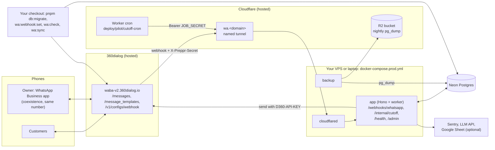

# Deploy: one kitchen, 360dialog coexistence

Stack: Docker Compose on a small VPS (or the laptop) with `deploy/pilot/docker-compose.prod.yml` (app, cloudflared, nightly backup), a Cloudflare named tunnel, Neon Postgres, a Cloudflare Worker cron for cutoff, and Sentry. Ops scripts (`pnpm wa:*`, `pnpm db:migrate`) run from a repo checkout with the same `.env`, not inside the container.

## What runs where



Only the `BOX` group is yours to run (one `docker compose up`). Everything else is a hosted account you configure once: 360dialog (key + webhook via `pnpm wa:webhook:set`), Cloudflare (tunnel token, Worker deploy, R2 bucket), Neon (`DATABASE_URL`, `pnpm db:migrate`), Sentry (DSN). Under `WA_PROVIDER=meta`, swap the 360dialog box for Meta Graph API; the webhook is set in the Meta app dashboard and signed with HMAC instead.

## 0. Prerequisites

- A domain on Cloudflare, a Neon project, a Sentry project (DSN), and a Cloudflare R2 bucket plus an API token (Object Read & Write).
- 360dialog: the kitchen's number onboarded with coexistence (Hub → Embedded Signup → "Connect existing WhatsApp Business app" → QR, with **history and contact sync** ticked), and the number's API key copied. It is shown only once.
- For a dry run first: the sandbox key (docs/360dialog.md, Sandbox).

## 1. Fill `.env`

```sh
cp .env.example .env
```

Set at least:

```sh
WA_PROVIDER=d360
WA_TOKEN=<360dialog API key>
WA_WEBHOOK_SECRET=$(openssl rand -hex 32)
BOT_NUMBER=+1<kitchen number>
OWNER_NUMBERS=+1<owner personal>
OPERATOR_NUMBERS=+1<you>
WA_COEXISTENCE=1
BOT_MODE=shadow                 # start here; see runbook "shadow → live"
PUBLIC_URL=https://wa.<domain>
DATABASE_URL=postgres://...neon.tech/neondb?sslmode=require
JOB_SECRET=$(openssl rand -hex 32)
SENTRY_DSN=...
TUNNEL_TOKEN=...                # step 2
R2_ACCOUNT_ID=... R2_ACCESS_KEY_ID=... R2_SECRET_ACCESS_KEY=... R2_BUCKET=preppr-backups
```

Plus the kitchen settings (`AREAS`, `TZ`, `CUTOFF_TIME`, `PAYMENT_INSTRUCTIONS`, `KITCHEN_NAME`) and the parser model (`LLM_*` / `ANTHROPIC_*`). For the Meta path, use `WA_PROVIDER=meta` with `WA_PHONE_NUMBER_ID`, `WA_APP_SECRET`, `WA_VERIFY_TOKEN`, `WA_WABA_ID`.

## 2. Cloudflare tunnel

1. Zero Trust → Networks → Tunnels → Create tunnel (cloudflared) → name `preppr` → copy the token into `TUNNEL_TOKEN`.
2. Public hostname: `wa.<domain>` → service `http://app:8080`. **No underscores and no port in the hostname** (360dialog rejects them).

## 3. Database

```sh
pnpm install
pnpm db:migrate                 # applies drizzle/ to Neon (the app also migrates at startup)
```

Neon gives two connection strings (`neon init` writes both to `.env`):

- `DATABASE_URL`: pooled (`-pooler` in the host, PgBouncer in transaction mode). The app uses this. It is safe because the worker only takes transaction-scoped advisory locks (`pg_advisory_xact_lock`) and keeps no session state.
- `DATABASE_URL_UNPOOLED`: direct. Use it for migrations and `pg_dump` (the backup service picks it up automatically):

```sh
DATABASE_URL="$(grep '^DATABASE_URL_UNPOOLED=' .env | cut -d= -f2-)" pnpm db:migrate
```

If you ever add `LISTEN/NOTIFY`, session-level `SET`, or `pg_advisory_lock` (non-xact), switch the app to the direct string.

## 4. Start the stack

```sh
docker compose --env-file .env -f deploy/pilot/docker-compose.prod.yml up -d --build
docker compose --env-file .env -f deploy/pilot/docker-compose.prod.yml ps        # app should be "healthy"
curl -s https://wa.<domain>/health                                # {"ok":true,"db":"ok",...}
docker compose --env-file .env -f deploy/pilot/docker-compose.prod.yml run --rm backup now   # first backup, check R2
```

Logs are rotated (10 MB × 5 per service): `docker compose --env-file .env -f deploy/pilot/docker-compose.prod.yml logs -f app`.

## 5. WhatsApp

```sh
pnpm wa:webhook:set             # POST /v1/configs/webhook with X-Preppr-Secret, polls until applied
pnpm wa:templates:sync          # creates daily_order_open (UTILITY) if missing
pnpm wa:check                   # key, webhook, template, DB, last inbound: all PASS (template may be PENDING for a while)
```

The template needs Meta's approval before the menu push can reach customers outside their 24 h window. `wa:check` shows FAIL until it reads APPROVED.

## 6. History and contacts (onboarding day)

Within minutes of onboarding:

```sh
pnpm wa:sync --from-db          # if history/state_sync events reached our webhook
pnpm wa:sync ~/Downloads/history.json   # otherwise: file downloaded from the 360dialog Hub
pnpm import:chat-export <export.txt|folder>   # last resort
```

## 7. Cutoff cron

```sh
cd deploy/pilot/cutoff-cron
# set PUBLIC_URL in wrangler.toml to https://wa.<domain>
npx wrangler secret put JOB_SECRET     # same value as .env
npx wrangler deploy
```

It calls `POST /internal/cutoff` with `Authorization: Bearer $JOB_SECRET` every 5 min, 9:00–14:55 New York time. The job is idempotent.

## 8. Monitoring

- UptimeRobot (or similar): `https://wa.<domain>/health` every 5 min, alert on non-200.
- Sentry alert rules (docs/monitoring.md): new issues, plus anything with an `alert` tag.
- Send yourself (operator) one WhatsApp to the kitchen number each morning so ops alerts can reach you inside the 24 h window.

## 9. Smoke test

Sandbox first (mind the 25-message cap):
1. Set `WA_API_URL=https://waba-sandbox.360dialog.io` and the sandbox key.
2. Run `pnpm wa:webhook:set`, then `pnpm wa:check` (template N/A).
3. From your phone, `ADD` yourself as a customer from the owner number (or let onboarding run), publish a menu, then send `2 dal`. Expect the summary with Confirm.
4. Check `raw_webhooks` has rows and `/health` shows `lastInboundAt`.

Then on the real number, in `BOT_MODE=shadow`:
1. A test customer orders. Expect no reply, and an order in `ORDERS`.
2. The owner replies in the Business app. Check `messages.source='app'` and that the customer is paused.
3. At cutoff, the summary says SHADOW.

Then follow the runbook to move to assist and live.

## Updating

```sh
git pull && docker compose --env-file .env -f deploy/pilot/docker-compose.prod.yml up -d --build
```

Migrations run at startup. With one instance that's fine.

## Staging: a test kitchen with coexistence

Meta's test number and the 360dialog sandbox can't do coexistence (no echoes, history or contact sync, and no templates on the sandbox). To test the real thing before touching the kitchen's phone, run a **staging kitchen** on a number we own. Keep it after go-live and try every change there first.

1. **Number:** a spare phone plus a prepaid SIM or eSIM from a real carrier. VoIP numbers often fail WhatsApp verification. Register it in the **WhatsApp Business app** (2.24.17+) and use it for about a week (chat with team phones) before onboarding.
2. **Accounts:** our own 360dialog account and Meta portfolio, not the kitchen's. Onboard the number the same way as switch-over day (docs/kitchen-meeting.md §5): Hub → Connect existing WhatsApp Business app → QR, with **history and contact sync ticked**. This is the rehearsal, so write down anything unexpected in docs/coexistence-setup.md.
3. **Separate everything:** a Neon branch or project, a tunnel hostname (`wa-staging.<domain>`), and its own `WA_WEBHOOK_SECRET`, `JOB_SECRET`, `ADMIN_SECRET`. Put them in `.env.staging` (gitignored like every `.env.*` except `.env.example`), with `BOT_NUMBER` = the test number, `OWNER_NUMBERS` = your personal number, `WA_COEXISTENCE=1` and `BOT_MODE=live` (it's our number).
4. **Run it** next to prod on the same machine:

   ```sh
   ENV_FILE=.env.staging docker compose -p preppr-staging --env-file .env.staging \
     -f deploy/pilot/docker-compose.prod.yml up -d --build
   ENV_FILE=.env.staging pnpm wa:webhook:set
   ENV_FILE=.env.staging pnpm wa:check
   ENV_FILE=.env.staging pnpm wa:sync <hub-history.json>
   ENV_FILE=.env.staging pnpm wa:templates:sync
   ```

   Every script that reads `.env` reads `$ENV_FILE` instead when it's set. Variables already set in the shell still win.
5. **Capture real payloads:** copy echo, history, state-sync and template-status bodies from `raw_webhooks` into `test/fixtures/webhooks/` (replace the phone numbers), and fix `src/wa/normalize.ts` / `src/flows/coexistence.ts` wherever they differ.
6. **Smoke test** (docs/coexistence-setup.md) with team phones as customers in `live`, then once each in `shadow` and `assist`.
7. **Kitchen feedback:** load the kitchen's real menu, areas, cutoff and payment text. The owner and a few regulars message the test number as customers, and the owner tries the commands from their personal number (add it to `OWNER_NUMBERS` for the session). Misparses become fixtures (`pnpm import:chat-export --fixtures`, `pnpm test:parser`).

Ready for the real phone when: the smoke test passes twice with no code changes in between, the parser holds on the kitchen's real messages, `daily_order_open` is approved as utility on the test WABA, the real payloads are covered by tests, and prod runs on the VPS.
