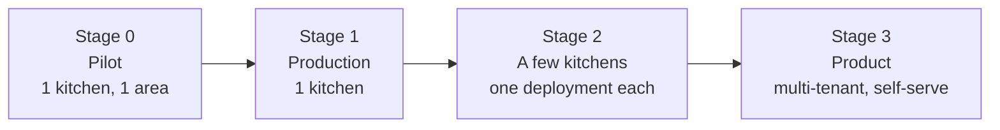
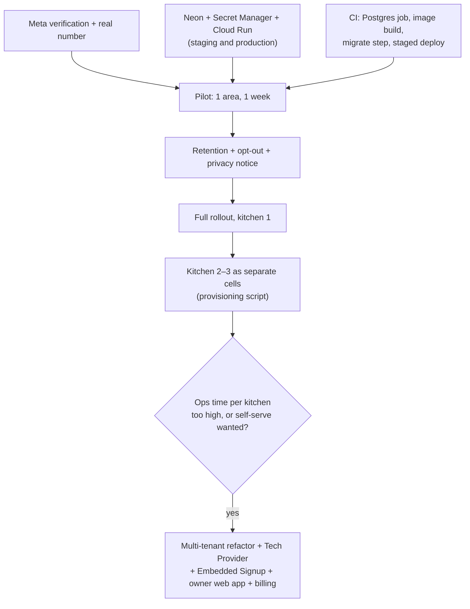

# Deployment plan

How Preppr gets from "works on test phones" to running for one kitchen, and then to a product that many kitchens can sign up for. It's a general plan meant to be refined. Decisions still open are listed at the end.

---

## 1. What has to run

Preppr is one Node process plus Postgres. Everything else is a hosted service it calls.

| Piece | What it is | Notes |
|---|---|---|
| App | `node dist/index.js` (Docker image from `Dockerfile`) | Serves the webhook and admin pages, and runs the worker (inbox, outbox, watchdog, Sheet sync) in the same process. |
| Postgres | Any Postgres 15+ | All state: customers, orders, payments, inbox/outbox queues, delivery statuses. No Redis or other queue needed. |
| Cutoff trigger | `POST /jobs/cutoff` with `X-Job-Secret` every 5 min during the morning | Cloud Scheduler, cron, or any HTTP scheduler. Idempotent. |
| WhatsApp | Meta app + WhatsApp Business Account + bot phone number | One number per kitchen. Webhook → `https://<host>/webhook`. |
| Parser model | Anthropic API (or any OpenAI-compatible API) | Only for messages the code parser can't read. |
| Optional | Sentry, UptimeRobot, Google Sheets service account | Monitoring and the owner's Sheet. |

**Runtime constraints:**
- **Always on with CPU allocated.** The worker runs after the webhook returns 200. Serverless platforms that freeze idle instances (Cloud Run's default CPU throttling, Lambda) will stall it. On Cloud Run use `--no-cpu-throttling --min-instances 1`.
- **Multiple instances are safe for the queues.** Claims are serialized with an advisory lock. Each instance does run its own watchdog and Sheet sync: alerts are deduped in `kv`, but the Sheet gets rewritten twice. Start with one instance (`max-instances 1–2`).
- **Migrations run at startup** on each instance (`connectPostgres(url, migrate = true)`). With more than one instance, or on a busy deploy, run `pnpm db:migrate` as a one-off step before rolling out, and start instances with migration off. This is a small code change.
- **Public HTTPS URL**, needed by Meta's webhook and the `CHATS` links (`PUBLIC_URL`).

---

## 2. Stages



| Stage | Kitchens | Hosting | Main work |
|---|---|---|---|
| 0. Pilot | 1 (20–30 customers) | Laptop + tunnel, or Cloud Run | Meta setup, real database, parser eval on real messages, one week side by side with manual orders |
| 1. Production | 1 (~500 orders/day) | Cloud Run + Neon | CI/CD, backups, alerts wired, runbook owner |
| 2. Few kitchens | 2–10 | One deployment per kitchen ("cell"), same image | Per-kitchen config and secrets, a script to stand up a new kitchen |
| 3. Product | 10+ | One multi-tenant deployment | Tenant model in the code, Meta Tech Provider + Embedded Signup, sign-up flow, billing, owner web app |

---

## 3. Stage 0–1: one kitchen

### Recommended stack

| Need | Choice | Why | Monthly cost |
|---|---|---|---|
| App | Google Cloud Run, `us-east4`, 1 vCPU / 512 MB, min 1 instance, CPU always allocated | Managed, HTTPS included, deploys from source or image | ~$10–20 |
| Database | Neon (Postgres), Launch plan | Backups and point-in-time restore; scales to zero for dev branches | $0–19 |
| Secrets | Google Secret Manager | Mounted as env vars in Cloud Run | ~$0 |
| Cutoff | Cloud Scheduler, `*/5 9-14 * * *` local time | Already documented in the README | ~$0 |
| Parser | Claude Haiku via Anthropic API | Code parser handles the simple messages | ~$2–15 |
| WhatsApp | Cloud API, service conversations | Replies inside the 24 h window are free | $0 (templates extra) |
| Monitoring | Sentry (free) + UptimeRobot (free) on `/readyz` | Setup in `monitoring.md` | $0 |
| **Total** | | | **~$15–55 per kitchen** |

Equally valid alternatives that run the same Docker image: Fly.io or Railway (simple, about the same cost), a small VPS with Docker Compose and Postgres (cheapest, but you own backups and updates), or the always-on laptop from `system-design.md` (fine for the pilot only).

### Environments

| Env | Database | WhatsApp | Purpose |
|---|---|---|---|
| local | PGlite (in memory) or a Neon dev branch | `WA_DRY_RUN=1` | `pnpm dev`, `pnpm simulate` |
| staging | Neon branch `staging` | Meta **test number**, test phones | Every merge to `main` deploys here; end-to-end checks |
| production | Neon `main` | Real bot number | Deployed from a tag or release |

### First production deploy, step by step

1. **Meta** (`meta-setup.md`): business verification, bot number, display name, permanent system-user token, webhook verify token, app secret. Start first; verification takes days.
2. **Database**: create the Neon project; copy the pooled connection string as `DATABASE_URL`.
3. **Secrets** in Secret Manager: `WA_TOKEN`, `WA_APP_SECRET`, `ANTHROPIC_API_KEY`, `DATABASE_URL`, `JOB_SECRET`, `ADMIN_SECRET`, `SENTRY_DSN`, `GOOGLE_SERVICE_ACCOUNT_JSON`.
4. **Deploy**: `gcloud run deploy` (README "Deploy"). Plain env vars: `TZ`, `AREAS`, `OWNER_NUMBERS`, `BOT_NUMBER`, `WA_PHONE_NUMBER_ID`, `WA_VERIFY_TOKEN`, `KITCHEN_NAME`, `PAYMENT_INSTRUCTIONS`, `PUBLIC_URL`, `SHEET_ID`, `KITCHEN_DAYS`, `MENU_EXPECTED_BY`.
5. **Webhook**: in the Meta app, set the callback to `https://<service>/webhook` with the verify token, and subscribe to `messages`.
6. **Scheduler**: create the cutoff job (README).
7. **Monitoring**: UptimeRobot on `/readyz`; Sentry alert rules (`monitoring.md`).
8. **Seed customers**: the owner shares contacts with the bot, or `pnpm import:customers contacts.vcf`.
9. **Smoke test** (README "How to test" checklist) with the owner and 2–3 phones before announcing.

### CI/CD

The current state is GitHub Actions running typecheck, tests and build on every push. To add:

1. A job with a Postgres service container, running the test suite against real Postgres as well as PGlite.
2. On merge to `main`: build the image, push it to Artifact Registry, run `db:migrate` against staging, deploy to staging.
3. On a release tag: migrate production, then deploy production with `--no-traffic`, smoke-check `/readyz` on the new revision, and shift traffic.
4. **Rollback**: shift traffic back to the previous revision. Migrations should be additive (new columns and tables) so the previous revision still runs against the new schema. Destructive changes go in a later release.
5. **Deploy outside the ordering window** (e.g. after 3 PM local). Draining is safe anyway: SIGTERM stops claiming, and leftover rows are picked up after the lease.

### Data, backups, security

- **Backups:** Neon point-in-time restore (7 days on Launch). Add a nightly `pg_dump` to a storage bucket with 30-day retention for an independent copy. Practice a restore once before launch.
- **Retention** (to build): delete message bodies and raw payloads older than ~90 days, and prune `inbox`/`outbox` rows older than ~30 days. Orders, payments and customers are kept.
- **Personal data held:** customer phone numbers, names, delivery notes, order history, payment reports, and message text. Needed before launch:
  - A short privacy notice (Meta requires a privacy policy URL for the app).
  - An owner-side way to delete a customer.
  - A "STOP" opt-out (to build).
- **Secrets:** only in Secret Manager or `.env` on an encrypted disk; never committed. Rotate `ADMIN_SECRET` to revoke all `CHATS` links.
- **Access:** the viewer is read-only via 12-hour signed links. Database access is limited to the developer.

---

## 4. Stage 2: a few kitchens, one deployment each

The fastest way to serve kitchens 2–10 is the same code with a separate deployment per kitchen, a "cell" model:

```
kitchen-a: Cloud Run service preppr-a  ─ Neon project a ─ WhatsApp number A ─ Sheet A
kitchen-b: Cloud Run service preppr-b  ─ Neon project b ─ WhatsApp number B ─ Sheet B
```

- **Pros:** no code changes; full isolation (one kitchen's data or outage can't touch another's); per-kitchen config is just env vars.
- **Cons:** ops work grows with each kitchen (deploys, alerts, scheduler jobs, secrets × N); about $15–55 per kitchen per month with no shared savings.
- **To make it manageable:**
  - Put the per-kitchen settings (env vars + secrets) in one config file per kitchen, kept in a private ops repo.
  - Write a script (or Terraform) that creates the service, database, scheduler job and secrets from that file.
  - Deploy every kitchen from the same image tag in CI.
  - Tag Sentry events with `SENTRY_ENVIRONMENT=kitchen-a`.
- **WhatsApp:** all numbers can live under one Meta app and your business portfolio (you act as the provider), or each kitchen can have its own portfolio. The first is simpler; it changes in Stage 3.

Move to Stage 3 when ops time per kitchen becomes the bottleneck, or when kitchens need to sign themselves up.

---

## 5. Stage 3: productizing (multi-tenant)

### 5.1 Tenant model in the code

Add a `kitchens` table and scope everything to it. What changes:

| Today | Multi-tenant |
|---|---|
| Config from env (`KITCHEN_NAME`, `AREAS`, `OWNER_NUMBERS`, `TZ`, `CUTOFF_TIME`, `PAYMENT_INSTRUCTIONS`, `KITCHEN_DAYS`, `SHEET_ID`, …) | Columns on `kitchens`, editable in an owner web app. `Config` becomes a per-request `KitchenConfig`, loaded by phone number id. |
| One WhatsApp number (`WA_PHONE_NUMBER_ID`, `WA_TOKEN`) | Per kitchen: phone number id, WABA id, access token (encrypted at rest). |
| Webhook from one number | Route by `entry[].changes[].value.metadata.phone_number_id` to the kitchen. |
| `customers.phone` is the primary key | `(kitchen_id, phone)`: the same person can order from two kitchens. |
| `menus.date` unique | `(kitchen_id, date)` |
| `orders`, `payments`, `messages`, `inbox`, `outbox`, `conversation_state`, `kv`, `wa_statuses` | Add `kitchen_id` with indexes. Queue claims key on `(kitchen_id, phone)`. |
| One cutoff job | One job loops over kitchens, using each kitchen's time zone and cutoff. |
| Watchdog / Sheet sync | Per kitchen, run on one leader instance (an advisory-lock leader, or a scheduled job instead of the in-process loop). |
| `CHATS` link signed with one secret | The token includes `kitchen_id`; viewer queries are filtered by it. |
| Sentry | Tag every event with `kitchen`. |

Isolation: every query takes a kitchen id, enforced in a small data-access layer (and optionally Postgres row-level security). Add a test that runs two kitchens through the same flows and checks nothing leaks between them.

### 5.2 WhatsApp onboarding at scale

- **Become a Meta Tech Provider** (or work through a Solution Partner/BSP such as 360dialog or Twilio, trading margin for less paperwork). This allows **Embedded Signup**: a kitchen clicks "Connect WhatsApp" on your site, logs in with Facebook, picks or creates its own WhatsApp Business Account and number, and you get a token for it.
- Each kitchen then owns its own business portfolio and number; display name approval and messaging limits are per kitchen.
- **Number choice per kitchen:**
  - (a) A new dedicated bot number (today's model; keeps broadcast lists on the owner's app).
  - (b) **Coexistence** on the owner's existing number. One number, full chat and contact sync, but broadcast lists are disabled, so the menu broadcast needs a replacement: Status, groups, or paid marketing templates.
  - Offer (a) by default and (b) as an option.
- **Message templates** become worth adding: "menu is out" to opted-in customers, balance reminders, and a summary that always reaches the owner. These are paid per message (Utility/Marketing pricing per country); pass the cost through or include a monthly allowance.

### 5.3 Kitchen sign-up flow (product)

1. Sign up (email or phone), kitchen name, time zone, delivery areas, payment instructions.
2. Connect WhatsApp (Embedded Signup) → number verified → webhook auto-subscribed.
3. Add regulars: share contacts to the bot, upload a `.vcf`, or skip.
4. Optional: connect a Google Sheet (OAuth instead of a service account).
5. Test mode: the owner orders from their own phone; the bot shows what customers will see.
6. Go live: the bot gives the owner the first broadcast text with the link.

### 5.4 Owner web app

This grows out of the `CHATS` viewer:
- Menu editor and history.
- Customers (areas, notes, block).
- Payments (verify in bulk).
- Today's board: live orders, kitchen totals, printable route sheets.
- Settings and billing.

WhatsApp commands stay as the fast path on the phone.

### 5.5 Billing

- Subscription per kitchen (e.g. a flat monthly tier by order volume) via Stripe.
- Usage that costs money: model calls (small, thanks to the code parser), paid templates, and SMS alerts. Meter these per kitchen in the database.
- A free trial using the kitchen's real number.

### 5.6 Operations for many kitchens

- **One status page** across kitchens: per-kitchen `/readyz`-style checks (backlog, last webhook received, last summary delivered).
- **Alert routing:** platform alerts (database down, queue stuck) go to you; kitchen alerts ("no menu by 9:00", "summary not delivered") go to the kitchen owner, by WhatsApp template or email.
- **Support tooling:** the transcript viewer with an internal "view as kitchen" mode (audited).
- **Reliability target:** each kitchen's ordering window. Deploy freezes during peak windows across time zones.
- **Data:** per-kitchen export (CSV of customers, orders, payments) and per-kitchen deletion on cancellation.

### 5.7 Compliance checklist

- WhatsApp Business Policy and Commerce Policy (food is allowed; no prohibited goods). Opt-in for any template messages.
- A privacy policy and terms for kitchens (data processor) and their customers.
- Regional data rules if expanding outside the US (e.g. GDPR in the EU/UK, DPDP in India).
- Card data never touches Preppr: payments stay in Zelle/Venmo/cash, or a later Stripe link.

---

## 6. Suggested order of work



## 7. Decisions to make

1. **Hosting:** Cloud Run + Neon (recommended) or Fly/Railway/VPS?
2. **Who owns the WhatsApp assets for kitchens 2+:** your portfolio (simpler now) or each kitchen's own (required for self-serve; needs Tech Provider status or a BSP)?
3. **Dedicated bot number or coexistence** as the default for new kitchens, and the replacement for broadcast lists if coexistence.
4. **When to go multi-tenant:** after which kitchen count, or when self-serve sign-up is needed?
5. **Pricing:** flat tiers by order volume, or per order?
6. **Templates:** which proactive messages are worth paying for (menu announcement, balance reminder, owner summary)?
7. **Retention period** for message text (suggested 90 days) and whether owners can export or delete their data themselves.
