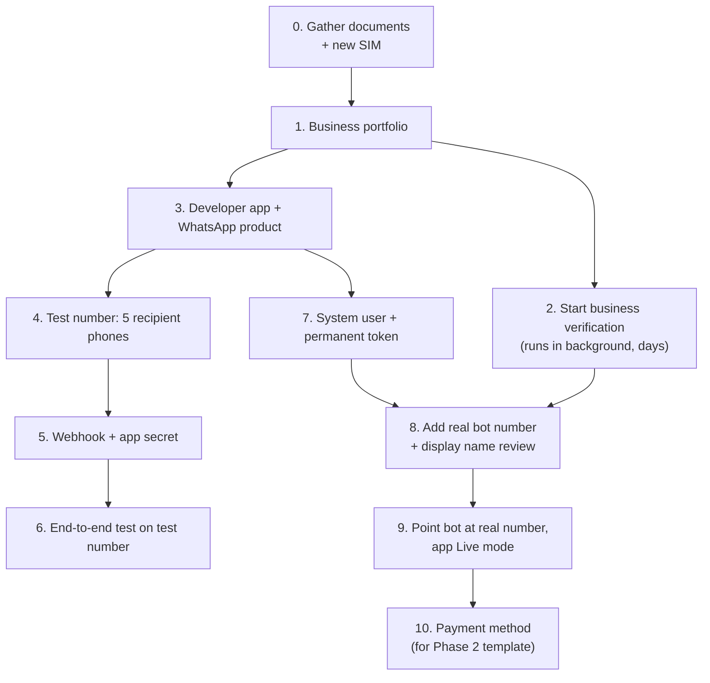

# Meta / WhatsApp Cloud API setup

Step-by-step setup for the bot's WhatsApp number. Do steps 1–2 first: business verification takes days to weeks, and nothing else depends on waiting for it.

Meta's dashboards change often. If a menu item has moved, the official guide is the reference: <https://developers.facebook.com/docs/whatsapp/cloud-api/get-started>.

---

## Overview



### The two numbers

| Number | Where it lives | Used for |
|---|---|---|
| Owner's existing number | WhatsApp Business app on the owner's phone | Daily broadcast lists, manual chats. **Do not** connect it to the API. |
| New bot number | WhatsApp Cloud API (this guide) | All customer ordering, owner commands |

**Do not use "coexistence"** (the same number on the Business app and the API). It disables broadcast lists, which the daily menu push depends on.

---

## 0. Before you start

- **A personal Facebook account** for the person doing setup. It becomes the admin of the business portfolio.
- **Legal business documents** with the exact legal name and address, for verification. Examples: articles of incorporation or business registration, an IRS EIN letter, a utility bill or bank statement in the business name.
- **A business website** (or at least a simple page) showing the same business name. It helps verification. A domain email (e.g. `orders@yourkitchen.com`) also helps.
- **A new phone number for the bot:** a new SIM or eSIM that has **never been registered on WhatsApp**, or whose WhatsApp account you delete first. It must be able to receive an SMS or voice call for a one-time code.
- **A credit or debit card** for the WhatsApp Business Account (step 10).
- **A privacy policy URL.** Needed to switch the app to Live mode (step 9). A simple page on the business website is fine.

---

## 1. Create a Meta Business portfolio

1. Go to <https://business.facebook.com> and create a business portfolio (formerly "Business Manager").
2. Use the **exact legal business name** and address from your documents.
3. Add a second admin (e.g. the owner) so access isn't tied to one person.

## 2. Start business verification

1. In the portfolio, open **Settings → Business info** (or **Security Center**) and click **Start verification**.
2. Upload the documents from step 0. The name and address must match exactly.
3. Meta may confirm by email, phone, or a domain check.
4. This runs in the background, usually days, sometimes longer. Continue with steps 3–7 meanwhile: the test number works without verification.

Why it matters: verification raises messaging limits, lets you add more numbers, and builds trust for the display name review.

## 3. Create the developer app

1. Go to <https://developers.facebook.com> → **My Apps → Create app**.
2. Pick the use case for connecting with customers through WhatsApp (app type **Business**).
3. Link the app to the business portfolio from step 1.
4. Add the **WhatsApp** product if it isn't added automatically. This creates a **WhatsApp Business Account (WABA)** and a free **test phone number**.
5. Note the **App ID** and, under **WhatsApp → API Setup**, the **WhatsApp Business Account ID** and the test number's **Phone number ID**.

## 4. Use the test number first

In **WhatsApp → API Setup**:

1. **Add recipient numbers:** up to **5** phones, each verified by a code sent over WhatsApp.
   - During testing, **the owner's phone must be one of the 5**, because the owner also talks to the bot (MENU, SUMMARY…). That leaves 4 slots for test customers.
2. Copy the **temporary access token**. It expires after ~24 hours; it's only for this step. Step 7 replaces it.
3. Send a test message to check that the account works:

```sh
curl -X POST "https://graph.facebook.com/v23.0/$WA_PHONE_NUMBER_ID/messages" \
  -H "Authorization: Bearer $WA_TOKEN" \
  -H "Content-Type: application/json" \
  -d '{"messaging_product":"whatsapp","to":"12015551234","type":"template",
       "template":{"name":"hello_world","language":{"code":"en_US"}}}'
```

The phone receives "Hello World". (This uses Meta's sample template. The bot itself never sends templates.)

## 5. Connect the webhook

The bot must be reachable at a public HTTPS URL first:

- **Laptop:** a named Cloudflare tunnel or an ngrok static domain; see [`../system-design.md`](../system-design.md#10-running-on-an-always-on-laptop). Don't use a quick tunnel: its URL changes on every restart.
- **Cloud Run:** the service URL.

Then:

1. Start the bot with `WA_VERIFY_TOKEN` set to a random string you choose.
2. In the app dashboard: **WhatsApp → Configuration → Webhook → Edit**.
   - **Callback URL:** `https://<your-host>/webhook`
   - **Verify token:** the same value as `WA_VERIFY_TOKEN`
   - Click **Verify and save**. Meta calls `GET /webhook`, and the bot echoes the challenge.
3. Under **Webhook fields**, **subscribe to `messages`**. Leave other fields off.
4. **App secret:** **App settings → Basic → App secret → Show**. Copy it into `WA_APP_SECRET`. The bot uses it to reject requests that didn't come from Meta.
5. Check that the app is subscribed to the WhatsApp Business Account (usually automatic):

```sh
# list
curl "https://graph.facebook.com/v23.0/$WABA_ID/subscribed_apps" -H "Authorization: Bearer $WA_TOKEN"
# subscribe if the list is empty
curl -X POST "https://graph.facebook.com/v23.0/$WABA_ID/subscribed_apps" -H "Authorization: Bearer $WA_TOKEN"
```

## 6. End-to-end test on the test number

With `.env` filled in (`WA_PHONE_NUMBER_ID` = the test number's ID, `BOT_NUMBER` = the test number itself, `OWNER_NUMBERS` = the owner's phone):

1. Owner sends `MENU Mon: Dal makhani 6, Roti 1 each. Cutoff 10:30` to the test number → preview with Publish/Edit.
2. Owner taps **Publish** → receives the broadcast text with the `wa.me` link.
3. From a test customer phone, tap the link → onboarding → order → **Confirm**.
4. Run the rest of the brief's checklist: edit, cancel, "same as yesterday", an unmatched item, a voice note, "talk to aunty", a late order, `SUMMARY`.
5. Watch the bot's logs for `bad webhook signature`, `send failed`, or `window_closed`.

## 7. Permanent token (system user)

The temporary token expires daily. Production uses a system user token that doesn't expire.

1. **business.facebook.com → Settings → Users → System users → Add.** Name it e.g. `preppr`, role **Admin**.
2. **Assign assets** to the system user:
   - **Apps:** your app, with full control.
   - **WhatsApp accounts:** your WABA, with full control.
3. **Generate new token:**
   - App: your app.
   - Expiration: **Never**.
   - Permissions: **`whatsapp_business_messaging`** and **`whatsapp_business_management`**.
4. Copy the token into `WA_TOKEN`. It is shown only once. Store it in Secret Manager (Cloud Run) or `.env` (laptop), never in git.

If the token ever leaks, revoke it on the same screen and generate a new one.

## 8. Add the real bot number

Business verification should be done, or well under way, before this step.

1. Open **WhatsApp Manager** (<https://business.facebook.com/wa/manage>) → **Phone numbers → Add phone number**. (Also reachable from **API Setup → Add phone number** in the app dashboard.)
2. **Display name:** what customers see, e.g. "Annapurna Tiffin". It must clearly relate to the business name or website; Meta reviews it, usually within a day or two. Generic names ("Food Orders") get rejected.
3. Category: **Restaurant** (or the closest match). Add a short description.
4. Verify the number with the SMS or voice code.
5. **Register** the number for the Cloud API if its status isn't **Connected**. This sets a 6-digit two-step verification PIN. Keep the PIN safe.

```sh
curl -X POST "https://graph.facebook.com/v23.0/$WA_PHONE_NUMBER_ID/register" \
  -H "Authorization: Bearer $WA_TOKEN" -H "Content-Type: application/json" \
  -d '{"messaging_product":"whatsapp","pin":"<6 digits>"}'
```

6. Check the status:

```sh
curl "https://graph.facebook.com/v23.0/$WA_PHONE_NUMBER_ID?fields=display_phone_number,verified_name,name_status,code_verification_status,quality_rating" \
  -H "Authorization: Bearer $WA_TOKEN"
```

Look for `name_status: APPROVED` and `quality_rating: GREEN`.

7. **Profile:** in WhatsApp Manager → the number → **Profile**, add the logo, description, address, website, and hours. Customers see this when they open the chat.

## 9. Switch the bot to the real number

1. Update `.env` or secrets:
   - `WA_PHONE_NUMBER_ID` = the real number's **Phone number ID** (not the phone number)
   - `BOT_NUMBER` = the real number in E.164, e.g. `+12015550199`; it goes into the `wa.me` link
2. Restart or redeploy the bot.
3. In the app dashboard, add the **privacy policy URL** (**App settings → Basic**), then switch the app from **Development** to **Live** mode. In Development mode, webhooks may only be delivered for app admins and testers, not real customers.
4. Send a message from a phone that is **not** a test recipient and confirm the bot replies.

## 10. Payment method

**WhatsApp Manager → Settings → Payment methods → Add.** The MVP sends only free replies, so nothing should be charged. The card is needed later for the Phase 2 utility template ("ordering is open until …"), at roughly $0.006 per message.

To set up the Phase 2 template later: **WhatsApp Manager → Message templates → Create template**. Category **Utility**. Text from the brief, with no menu items, prices, or promo language. If Meta re-categorizes it as **Marketing**, it won't deliver to US numbers. In that case, keep using broadcast lists.

---

## Environment variables from this setup

| Variable | Where it comes from |
|---|---|
| `WA_TOKEN` | Step 7 (system user token). Temporary token from step 4 only for first tests |
| `WA_PHONE_NUMBER_ID` | API Setup → Phone number ID (test number in step 4, real number in step 9) |
| `WA_APP_SECRET` | App settings → Basic → App secret (step 5) |
| `WA_VERIFY_TOKEN` | Any random string you choose; same value in the webhook config (step 5) |
| `BOT_NUMBER` | The bot's own number in E.164 (test number, then real number) |
| `OWNER_NUMBERS` | Owner phone(s) in E.164, comma-separated |

`WABA_ID` and the App ID are only needed for the `curl` checks above, not by the bot.

---

## Gotchas

- **Test number:** it can only message the 5 verified recipients, and the owner uses one slot.
- **A number on the API can't also be used in the WhatsApp app.** Don't install WhatsApp with the bot SIM after registering it.
- **Webhook must answer fast with a valid HTTPS certificate.** The bot replies 200 immediately. Slow or failing responses make Meta retry and eventually disable the webhook.
- **The bot replies only within 24 h of the customer's last message**, by design. Nothing reaches a customer who hasn't messaged the bot that day.
- **Quality rating:** if many customers block or report the bot number, its rating drops and Meta can restrict it. Keep replies short and useful, and never message customers unprompted.
- **Graph API version:** the bot defaults to `v23.0` (`WA_GRAPH_VERSION`). Meta retires old versions roughly two years after release; bump it when the dashboard warns.
- **The owner's broadcasts only reach customers who saved the owner's business number in their contacts.** That's a WhatsApp rule for broadcast lists, not something the bot can fix.
