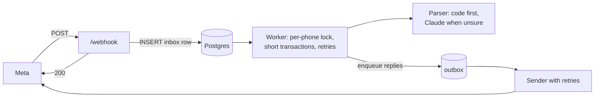
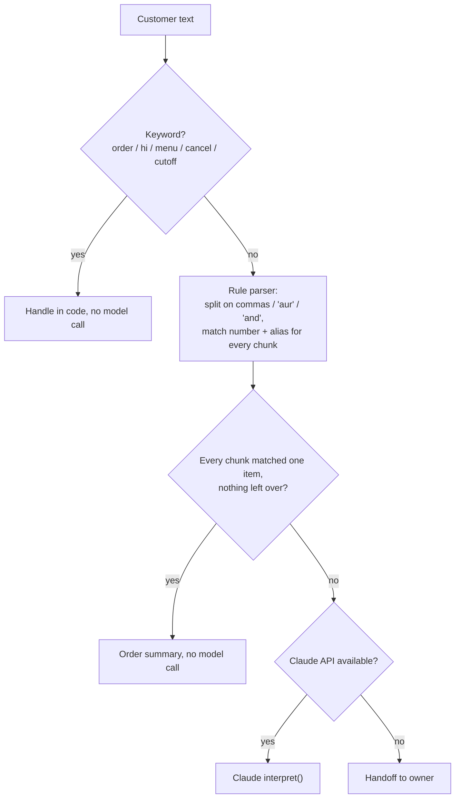
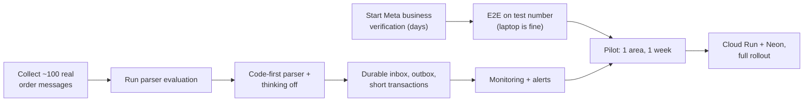

# Production readiness

What's left before the bot can take real orders reliably, and how to keep the parsing cost down.

Status as of 2026-10-23: durable inbox/outbox, payments, Google Sheet export and monitoring are built and tested (77 tests, simulated full day). Tried with a few test WhatsApp users; not yet deployed with a permanent database, and the parser has not been evaluated on real customer messages.

---

## 1. What "99% reliable" means here

Uptime alone is the wrong measure. The bot only matters during the ordering window (about 8:00–10:30 AM ET). Target:

- **99% of customer messages during the ordering window get a correct reply within 1 minute.**
- **99% of confirmed orders appear in the cutoff summary.**

Both can be measured from the `messages` and `orders` tables: an inbound message with no outbound message to the same phone within 60 s is a miss.

Everything the bot depends on is a link in a chain: WhatsApp Cloud API, the host (laptop or Cloud Run), Postgres, and the Claude API. Their availabilities multiply. Removing the hard dependency on the Claude API (section 3, item 9) is the cheapest way to raise the total.

---

## 2. Blockers: can't launch without these

- [ ] **Meta setup.** Business verification, the real bot number, display name approval, a permanent token, and the webhook. Verification takes days, so start first. Step by step: [meta-setup.md](./meta-setup.md).
- [ ] **End-to-end run on Meta's test number** with 3–5 real phones, following the brief's "done when" checklist: owner publishes, new customer onboards, ~10 varied orders, Confirm buttons, handoff, late order, cutoff summary.
- [ ] **Real parser evaluation.** Get ~100 anonymized order messages from the owner's past 1:1 chats. Put them in `test/fixtures/orders.json` and run `pnpm test:parser` (Claude, or any model set via `LLM_PROVIDER`; see the README). Until this runs, parser accuracy is unknown.
- [ ] **Permanent database.** Neon (managed, with backups and point-in-time restore) or a local Postgres with nightly `pg_dump` off the machine. Never run production without `DATABASE_URL`: the in-memory fallback loses everything on restart.
- [ ] **First real deploy.** The Docker image hasn't been built yet. Build it, deploy once (Cloud Run or the laptop), and point the Meta webhook at it.

---

## 3. Reliability work: needed for 99%

### 6. Durable inbox (done)

**Problem:** the webhook replies 200 to Meta *before* the message is saved. If the process crashes or restarts in between, the message is lost, and Meta won't resend it because it got a 200.

**Fix:** insert the raw message into an inbox table, *then* return 200. A worker processes the inbox with retries. [`pg-boss`](https://github.com/timgit/pg-boss) provides this on top of Postgres, with no new infrastructure.

### 7. Short transactions (done)

**Problem:** each message holds a database transaction, and therefore a pooled connection, open for the whole Claude call and the WhatsApp sends (1–3 s). The pool has 10 connections, so the rush right after the broadcast queues up.

**Fix:** keep the per-phone lock, but read state, call Claude outside any transaction, then write and send in short steps.

### 8. Outbound retries (done)

**Problem:** a failed WhatsApp API send is logged and dropped. The customer never sees their summary or confirmation.

**Fix:** an outbox table, sent by a worker with retries. Make it idempotent per (inbound message id, step) so a retry can't double-send.

### 9. Claude fallback (done)

**Problem:** if the Claude API is down or slow, every order fails with "didn't catch that".

**Fix:** a deterministic parser in code (section 6) handles simple orders on its own. When the model is unavailable, anything the code parser can't handle goes to the owner as a handoff instead of failing.

### 10. Monitoring and alerts (done, see [monitoring.md](./monitoring.md))

- [x] `/readyz` (database + queue backlog) for UptimeRobot. Create the monitor once deployed.
- [x] Every `ERROR` log goes to Sentry when `SENTRY_DSN` is set. Create the project and alert rules.
- [x] Alert when the cutoff summary hasn't been delivered by 30 minutes after cutoff (`summary_late`).
- [x] Alert if no menu is published by `MENU_EXPECTED_BY` on a kitchen day (`no_menu`).

### 11. Abuse protection (done)

Rate limit per phone, e.g. at most 20 messages per 10 minutes, and silently ignore the excess. Stops one spammer from running up model costs or slowing everyone else down.

### 12. Load test

Simulate ~50 customers messaging within 1–2 minutes of the broadcast against a real deploy. Check p95 reply time stays under ~10 s and nothing queues behind the connection pool.

---

## 4. Operations

- [ ] **Pilot:** one area, 20–30 customers, for one week. The owner keeps accepting manual orders as a backup. Compare the cutoff summary to what the owner would have written by hand.
- [ ] **Fallback plan:** if the bot is down during the window, the owner sends a broadcast: "Bot is down — reply to this number with your order today." Write this message in advance.
- [x] **Runbook:** in [monitoring.md](./monitoring.md#runbook). Add who to call.
- [ ] **Secrets:** `WA_TOKEN`, `WA_APP_SECRET`, `ANTHROPIC_API_KEY`, `DATABASE_URL`, `JOB_SECRET` live in Secret Manager (Cloud Run) or in a `.env` on an encrypted disk (laptop). They are never committed.

---

## 5. Hosting choice

| | Laptop | Cloud Run + Neon |
|---|---|---|
| Cost | ~$0 | ~$10–20/month (min 1 instance) + Neon free or ~$20/month |
| Realistic availability in the morning window | Good until Wi-Fi drops, power cuts, or an OS update restarts it | 99.9%+ for the hosting piece |
| Setup | Tunnel, cron, pm2, no-sleep settings | `gcloud run deploy` + Cloud Scheduler |
| Recommendation | Fine for the test-number phase and the pilot | Move here before full rollout |

Both run the same code. Laptop setup is in [`../system-design.md`](../system-design.md#10-running-on-an-always-on-laptop); Cloud Run deploy commands are in the [README](../README.md#deploy-cloud-run--cloud-scheduler).

---

## 6. Parsing cost and alternatives

### Current cost

- About 1,000 model calls per day. Only free-text messages call the model; button taps don't.
- Each call is ~1,200 tokens in and a few hundred tokens out.
- Claude Haiku 5.5 costs $0.10 per million input tokens and $0.50 per million output tokens.
- **Total: about $0.30–0.60 per day, or $10–20 per month.**

One wrong order, or half an hour of the owner's time sorting one out, costs more than a month of parsing. So judge every option on accuracy first, then on price.

### Options

| Option | Saving | Accuracy risk | Notes |
|---|---|---|---|
| **Code parser first, model only when unsure** (recommended) | Likely 50–80% fewer model calls | None added: anything unclear still goes to the model | Most messages are "2 dal 3 roti", "Order", or "hi". Matching item names, aliases and number words (ek, do, teen, char) in code handles them. Faster, and keeps simple orders working when the Claude API is down (item 9). |
| **Turn off Haiku's thinking** | Fewer output tokens, lower latency | Re-run the parser evaluation to confirm | One-line change in `src/llm/anthropic.ts`. Haiku 5.5 allows thinking off at `low` effort. |
| Prompt caching | Little or none | None | The prompt is likely below the minimum cacheable size. Not worth doing. |
| Other cheap hosted models (Gemini Flash-Lite, small GPT models, Llama on Groq or Together) | Possibly lower; check current prices | Unknown on Hinglish, edits, "same as yesterday" | Swapping costs one adapter file: all model calls go through the `Llm` interface in `src/llm/types.ts`. Run the same evaluation before switching. |
| Local model (Ollama, ~8B model on the laptop) | $0 per call | Higher: weaker on Hinglish and edits; 2–5 s per reply | Ties parsing to the laptop. Not recommended for live orders. |

### How the code-first parser would decide

The rule parser must be strict: it only accepts a message when every part of it matches exactly one menu item. Anything ambiguous goes to the model. Its accuracy is checked with the same `test/fixtures/orders.json` evaluation.

### Recommendation

1. ~~Build the code-first parser~~ (done: `src/llm/rules.ts`). Try thinking off. This likely brings model cost down to a few dollars a month, and it also delivers item 9.
2. Add a comparison mode to the parser evaluation (same fixtures, several models, accuracy and cost side by side).
3. Switch providers only if another model matches Claude's accuracy on the owner's real messages.

---

## 7. Suggested order of work

Meta verification and collecting real messages can start today, in parallel with the code work.
