# System design: WhatsApp tiffin ordering bot

How the MVP works today: who talks to whom, where data lives, and what runs when. The last sections cover running it on an always-on laptop and what to improve next.

---

## 1. The big picture

Two WhatsApp numbers, two jobs:

- **Owner's existing number** (WhatsApp Business app on the owner's phone): sends the daily menu to broadcast lists and handles manual chats. The bot never touches it.
- **Bot number** (new SIM, WhatsApp Cloud API): every customer order happens here, in 1:1 chats.

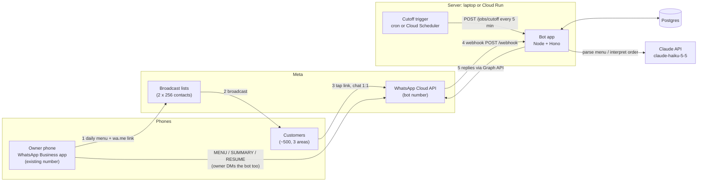

**Cost rule behind the design:** a reply within 24 h of the customer's last message is free, and US numbers can't receive marketing templates. So the bot only ever *replies*. The daily "menu is out" push goes through the owner's broadcast lists instead.

---

## 2. A day, end to end

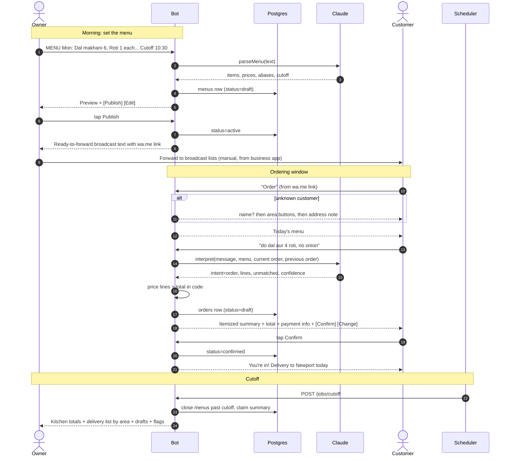

---

## 3. What happens to one inbound message

The webhook answers Meta immediately, then does the real work in the background. Everything for one message runs inside a single database transaction.

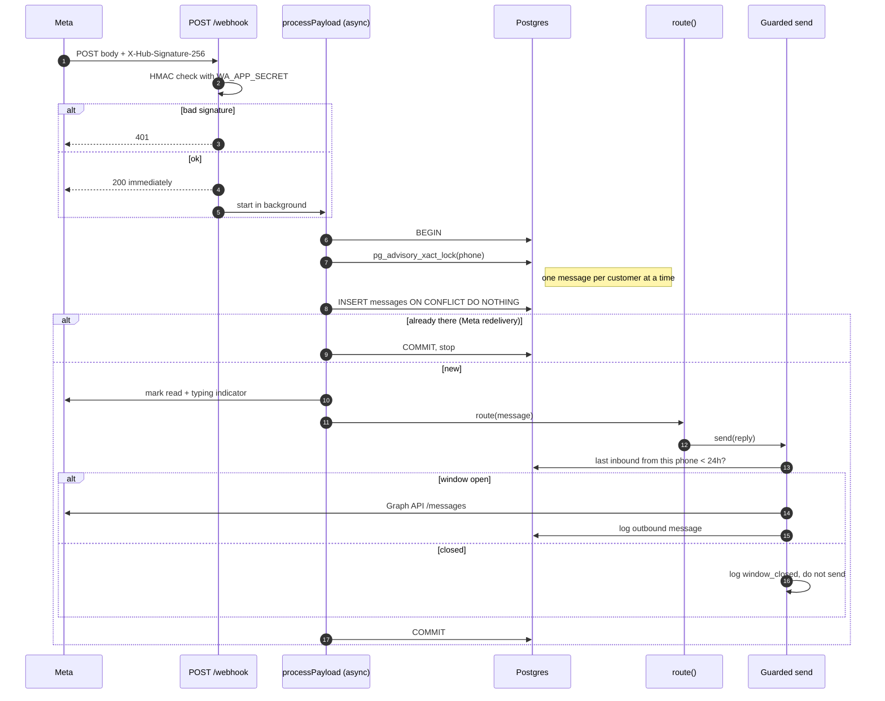

---

## 4. Routing decisions

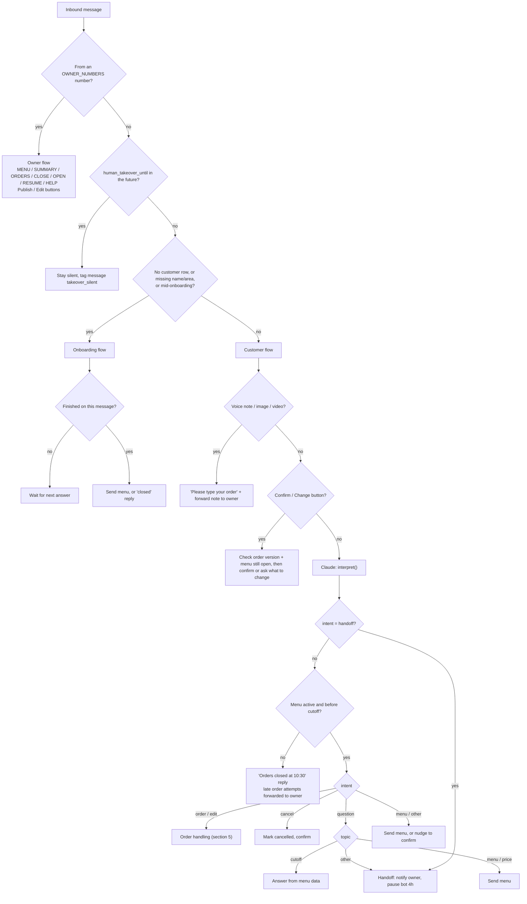

---

## 5. Order handling: when the bot trusts the parse

The model only returns **item ids and quantities**. Prices and totals always come from the menu in code (`src/domain/order.ts`).

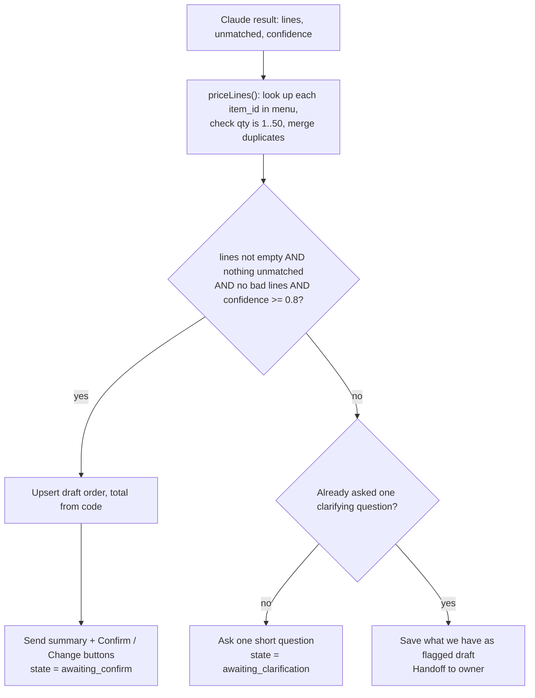

---

## 6. State machines

### Conversation state (per phone, `conversation_state`)

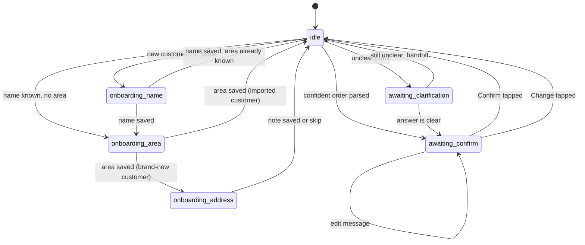

### Menu status

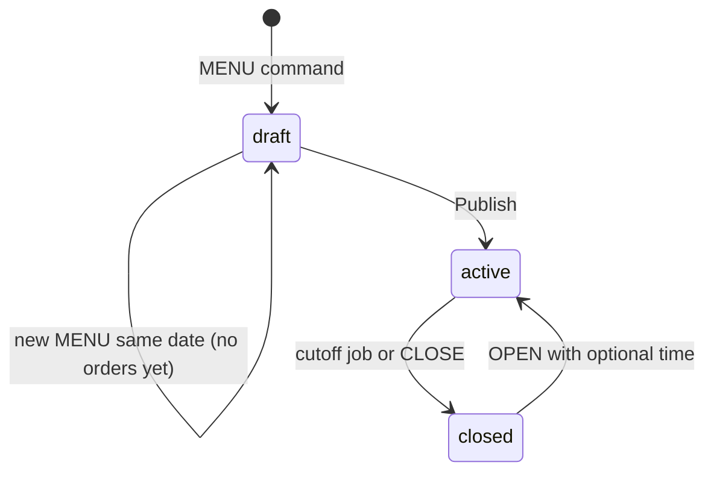

### Order status

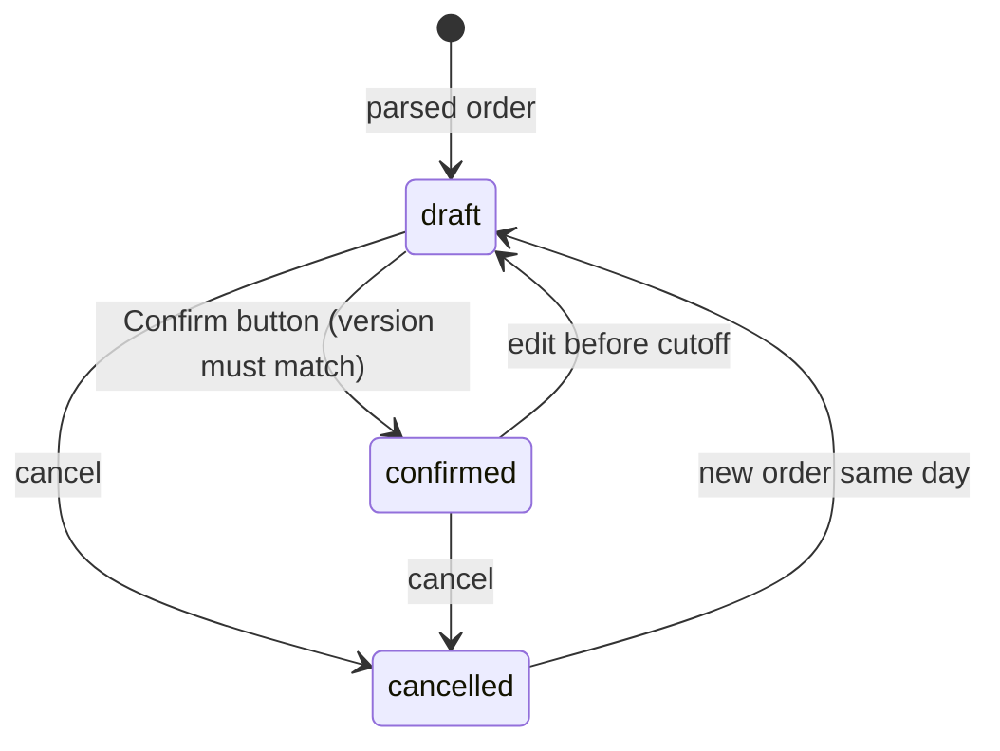

---

## 7. Cutoff job

Runs every 5 minutes through the morning. Running it twice is harmless.

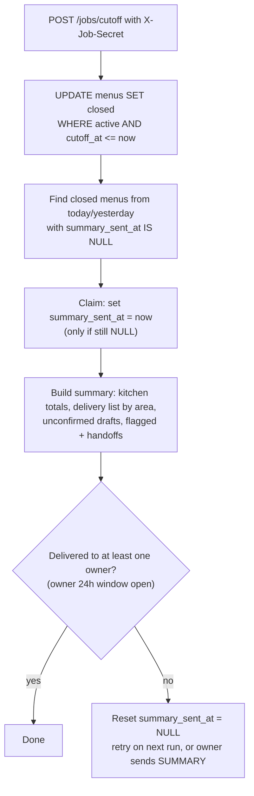

---

## 8. Data model

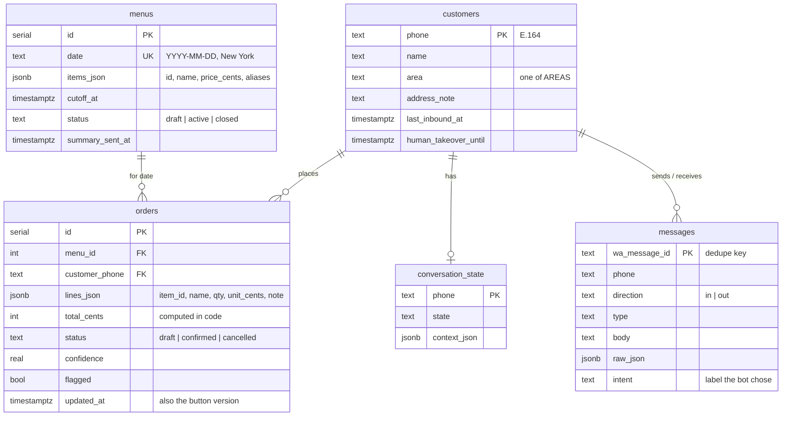

`orders` has a unique key on `(menu_id, customer_phone)`: one order per customer per day, and edits update that row. `messages` doubles as the 24-hour window clock and as a raw log for building eval sets later.

---

## 9. Code map

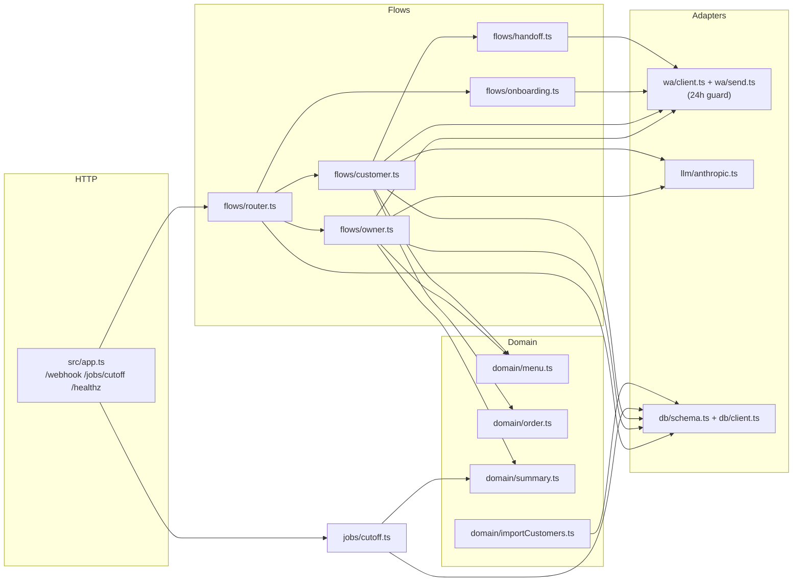

---

## 10. Running on an always-on laptop

Yes, it works. The app is one Node process plus Postgres. Nothing in the code depends on Google Cloud. Cloud Run and Cloud Scheduler are swapped for three local pieces:

| Cloud Run setup | Laptop setup |
|---|---|
| Public HTTPS URL from Cloud Run | **Tunnel** with a fixed URL: Cloudflare named tunnel (needs a domain on Cloudflare) or an ngrok free static domain |
| Cloud Scheduler | **cron** (or launchd) running `curl` every 5 min |
| Neon / Cloud SQL | **Postgres**: local (`brew install postgresql@16`) or keep Neon's free tier |
| Cloud Run restarts crashed containers | **pm2** or a launchd agent restarts the process |

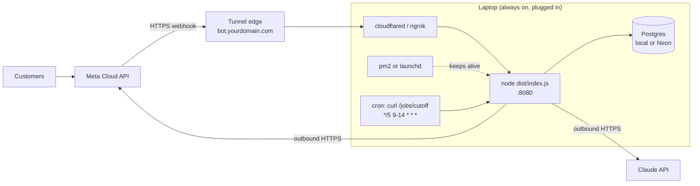

### Setup

```sh
# 1. Build and run under a supervisor
pnpm install && pnpm build
npm i -g pm2
pm2 start "node --env-file=.env dist/index.js" --name preppr
pm2 save && pm2 startup          # restart after reboot

# 2. Fixed public URL (pick one)
cloudflared tunnel create tiffin            # then route bot.yourdomain.com -> http://localhost:8080
cloudflared tunnel run tiffin
#   or: ngrok http --url=<your-free-static-domain>.ngrok-free.app 8080
# Put https://<that-host>/webhook in the Meta webhook config.

# 3. Cutoff job (crontab -e). cron uses the laptop's time zone: keep it on New York time.
*/5 9-14 * * * curl -s -X POST -H "X-Job-Secret: <JOB_SECRET>" http://localhost:8080/jobs/cutoff >/dev/null

# 4. Keep the Mac awake
sudo pmset -a sleep 0 disksleep 0     # or: caffeinate -s (while on power)
```

Required in `.env`: set `DATABASE_URL`. Without it the app uses an in-memory database and **loses all orders on restart**.

Avoid cloudflared "quick tunnels" (`--url` with no named tunnel). Their URL changes on every restart, and the Meta webhook would then need re-pointing each time.

### Laptop risks and cheap fixes

| Risk | Effect | Fix |
|---|---|---|
| Laptop sleeps, OS update reboots, Wi-Fi drops | Webhooks fail during the ordering window | Disable sleep and auto-update restarts; pm2 startup; wired network if possible |
| Power cut | Battery covers the laptop, but not the router | Small UPS for the router |
| Nobody notices it's down | Orders silently lost | Free uptime monitor (e.g. UptimeRobot) pinging `https://<tunnel>/healthz`, alerting the owner by SMS |
| Disk dies / laptop stolen | Customer list + order history gone | Use Neon for Postgres (free tier) or a nightly `pg_dump` to cloud storage |
| Secrets on disk | `.env` holds WA token and API key | FileVault on, laptop user account not shared |

Meta retries webhooks that fail, so short outages usually recover. Messages that arrive while the laptop is down get processed when it comes back, but the customer sees no reply until then. The cutoff job catches up on the next cron run after the laptop wakes.

**When to move to the cloud:** once the business depends on it every day, a laptop outage during the 8–10:30 AM window costs real orders. Cloud Run with `min-instances 1` costs roughly $10–20/month. Moving needs no code change, only the deploy steps in the README.

---

## 11. Known weaknesses and how to improve

Ordered by how much they matter at ~500 customers.

### Reliability

1. **Work after the 200 isn't durable.** If the process crashes after replying 200 to Meta but before committing, that message is lost (Meta won't retry a 200).
   *Fix:* durable inbox. Insert the raw message before returning 200, process from the table with a worker, mark done. `pg-boss` (a Postgres-backed queue) adds retries and keeps it all in Postgres.

2. **The transaction is held open during the Claude call and the WhatsApp sends.** Each message keeps a DB connection busy for 1–3 s. The pool has 10 connections, so a morning burst queues up.
   *Fix:* hold the per-phone lock, but split the work. Read state, call Claude outside the transaction, then write and send in short steps.

3. **Failed outbound sends are logged but not retried.** A Graph API hiccup means the customer never sees their summary.
   *Fix:* outbound queue with retries (same `pg-boss`), idempotent by `(inbound message id, step)`.

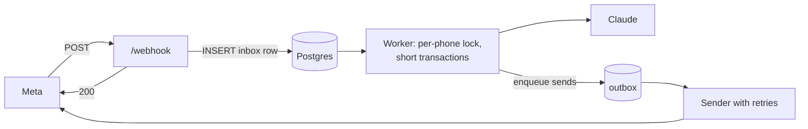

### Owner workload

4. **Daily manual broadcast.** Phase 2 utility template ("ordering is open until 10:30, reply MENU") could replace it, if Meta classifies it as utility.
5. **Summary depends on the owner's 24 h window.** It works because the owner sends MENU each morning. A utility template to the owner number would remove that dependency.
6. **A published menu with orders can't be edited.** Add "sold out" (`SOLDOUT paneer`) and price edits that keep item ids stable instead of replacing the menu.

### Customer experience

7. **Every free-text message calls Claude**, even "Order" or "hi". A keyword fast path skips the model for these, saving ~1 s and cost.
8. **Clarify budget is one question.** Watch real data before raising it. Handoffs cost owner time; wrong orders cost food.
9. **Voice notes:** forward the actual audio to the owner, or transcribe (Phase 2).

### Knowing it works

10. **Parser eval is placeholder data.** Replace `test/fixtures/orders.json` with ~100 real anonymized messages and run `pnpm test:parser` before any prompt change. The `messages.intent` column already labels live traffic, so mismatches can be reviewed and added to the set.
11. **No dashboard.** A daily CSV or Google Sheet export of `orders` gives the owner a view without new UI.
12. **Payments:** text instructions only. Next step is a `paid` flag set by an owner command (`PAID +1201…`) and a weekly unpaid list.

### Rough running cost

| Item | Estimate |
|---|---|
| WhatsApp replies | $0 (all inside the 24 h window) |
| Claude (Haiku 5.5): ~2,000 messages/day × ~1.5k tokens in, ~300 out | ≈ $0.60/day |
| Laptop hosting | $0 + electricity; Cloud Run later ≈ $10–20/month |
| Postgres | $0 local or Neon free tier |
